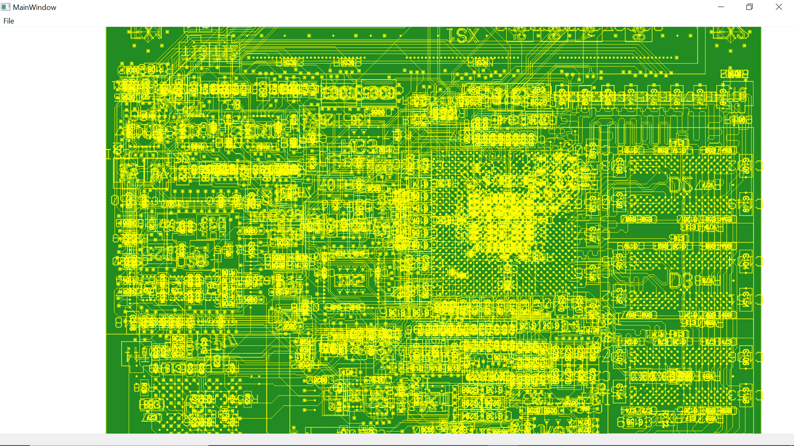

# Visualiseur Industriel de Cartes Électroniques (ODB++ PCB Viewer)

Application de visualisation 2D vectorielle de circuits imprimés (PCB) à partir du format standard de fabrication **ODB++**, développée en **C++** avec le framework **Qt**.

Projet d'ingénierie logicielle réalisé en partenariat avec **Temento Systems** dans le cadre de la Licence Mathématiques-Informatique (Université Grenoble Alpes).

---

## Aperçu de l'application

### Détails et fonctionnalités
| Rendu des pistes et composants | Gestion et masquage des couches |
| :---: | :---: |
|  |  |

| Vue des signaux | Autre affichage |
| :---: | :---: |
|  |  |

---

## Fonctionnalités principales

- **Parser ODB++ :** Lecture et modélisation en mémoire des couches (`matrix`), des composants et des primitives géométriques depuis l'arborescence ODB++.
- **Moteur de rendu vectoriel (Qt) :** Affichage optimisé des pistes de cuivre, pastilles (pads) et plans de masse via `QPainter` et `QPainterPath`.
- **Navigation interactive :** Déplacement dynamique (pan) et zoom fluide à la souris.
- **Gestion des couches :** Panneau latéral (`QDockWidget`) avec cases à cocher permettant d'afficher ou masquer sélectivement les couches de la carte.
- **Filtrage intelligent :** Masquage automatique des couches de masque de soudure ou de documentation pour conserver une lisibilité optimale des pistes de signaux.

---

## Architecture logicielle (MVC)

L'application repose sur le patron de conception **Modèle-Vue-Contrôleur (MVC)** :
- **Modèle (`Product_Model`) :** Structures de données C++ représentant la carte, les couches et les formes géométriques via héritage et polymorphisme (`Form` -> `Pad`, `Line`, `Arc`, `Text`, `Surface`).
- **Vue (`Viewer2D`) :** Composant Qt personnalisé assurant le tracé vectoriel dans l'événement `paintEvent`.
- **Contrôleur (`ApplicationController`) :** Gestion des interactions utilisateur, ouverture des dossiers et déclenchement de l'analyse du parser.

---

## Technologies

- **Langage :** C++17
- **IHM :** Framework Qt (Widgets, QPainter, QDockWidget)
- **Outils :** CMake, Git
